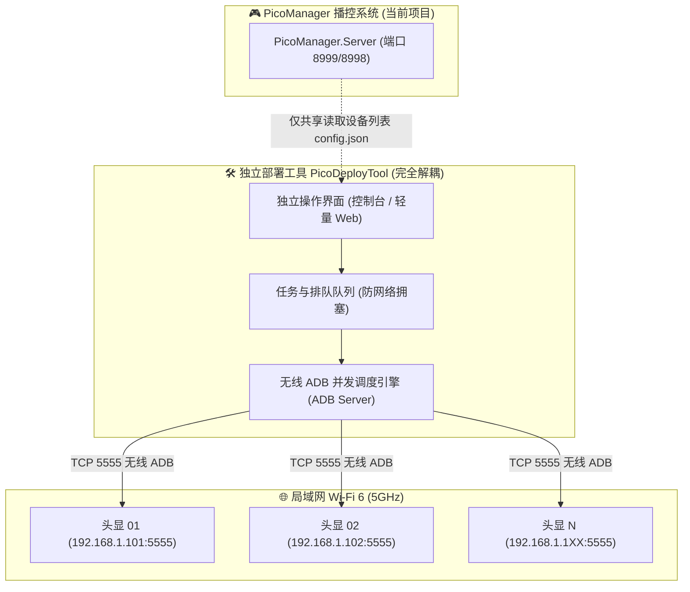

# PICO 设备文件传输与 APK 批量安装独立技术方案

> **设计原则**：**完全与当前管理播控系统代码解耦**，作为独立的辅助工具或独立微服务运行，不影响当前系统的稳定性与实时控制性能。

---

## 一、 需求与挑战分析

在 VR 线下门店和展厅运维中，经常需要：
1. **大文件传输**：全景视频（单个文件 2GB~10GB）、游戏数据包（OBB / Assets）更新；
2. **APK 批量静默安装与升级**：不能要求操作员逐台戴上头显点击“确认安装”；
3. **多机并发管理**：10~30 台设备同时分发，不能造成 Wi-Fi 路由器丢包崩溃；
4. **代码解耦与独立性**：该功能属于**一次性或低频运维工具**（通常在开业前或换展时使用），与日常高频的**播控调度系统（PicoManager）必须物理隔离**，避免大流量文件传输挤占播控信令端口。

---

## 二、 三种技术实现方案对比

| 对比维度 | 方案一：独立无线 ADB 批量分发工具 (推荐) | 方案二：局域网 HTTP 分发源 + PICO 企业套件 MDM | 方案三：头显端定制 Sidecar 伴侣服务 |
| :--- | :--- | :--- | :--- |
| **头戴端依赖** | **零依赖** (利用 Android 原生调试通道) | 依赖 `com.picovr.enterpriseassistant` 具备下载安装权限 | 需要额外在头戴内开发并安装一个接收 APK |
| **静默安装支持** | **原生支持** (`pm install -r -d`)，无任何弹窗 | 支持 (通过企业权限调用 `PackageInstaller`) | 支持 (需申请系统签名或设备所有者权限) |
| **文件传输路径** | 可直达任意存储目录 (`/sdcard/Movies/`, `/sdcard/Android/data/...`) | 通常仅限应用沙盒或受限下载目录 | 取决于自定义服务实现 |
| **传输速度** | **千兆局域网满速** (30~60 MB/s / 台) | 受限于 HTTP 下载断点续传实现 | 受限于 WebSocket/Socket 实现 |
| **耦合度** | **100% 完全独立** (独立 EXE / 独立脚本) | 与 PICO 企业服务端有一定接口依赖 | 需要维护单独的 VR 端 App |
| **实施复杂度** | **极低** (成熟工具链，1~2 天即可落地) | 中等 (需调试 PICO MDM 接口) | 较高 (需维护 PC 端和 Android 端两套代码) |

---

## 三、 推荐落地方案：【方案一】独立无线 ADB 批量分发系统 (`PicoDeployTool`)

### 1. 总体架构图 (完全物理隔离)



### 2. 核心工作原理

1. **无线 ADB 通道开启 (仅需一次)**：
   PICO 头显（PICO 4 / Neo 3 / Ultra）底层基于 Android 10/12 系统。首次开机或在开发者设置中勾选“允许无线调试”，即可开启 `TCP 5555` 端口；亦可通过 USB 插入一次执行 `adb tcpip 5555` 后拔掉，之后始终走 Wi-Fi 通信。
2. **静默安装 APK 命令**：
   无需人工点击头显内部确认，通过无线通道直接下发底层包管理指令：
   ```bash
   # 连接指定头显
   adb connect 192.168.1.101:5555
   # 静默覆盖安装 APK，保留数据
   adb -s 192.168.1.101:5555 install -r -d "D:\Games\hunaochufang.apk"
   ```
3. **高速传输视频与资源文件**：
   将全景视频、游戏 OBB 或配置文件秒级推入头戴闪存：
   ```bash
   adb -s 192.168.1.101:5555 push "D:\Videos\DeepSea_8K.mp4" "/sdcard/Movies/"
   ```
4. **并发控制与错峰限速 (防网络风暴)**：
   若 20 台机器同时拉取 5GB 视频，会把无线路由器带宽打满。独立工具内置**并发调度器（如最多同时传输 3~4 台，队列等待）**，并输出清晰的传输百分比进度条与安装成功回执。

---

## 四、 独立工具的产品形态规划

该工具可以作为一个**完全独立的单文件绿色工具**提供，存放在独立的目录中（例如 `tools/PicoDeployTool/`），完全不引入任何与 `PicoManager.Server` 的项目引用。

### 功能模块划分：
1. **设备探测器**：自动扫描局域网内开放 5555 端口的 PICO 头显，或直接读取 `config.json` 中已绑定的 IP 列表；
2. **文件/APK 拖拽窗口**：直接将 `.apk` 或 `.mp4` 拖入窗口，勾选目标机器（如“全部设备”或“01~05号机”）；
3. **分发执行引擎**：并发执行，显示各机位进度（如 `[01号机] 安装中 75%`, `[02号机] 传输完成`）；
4. **一键清理功能**：远程删除头戴内的旧视频、旧缓存或旧版本 APK 释放空间。

---

## 五、 总结与建议

- **当前阶段**：严格遵照您的指示，**暂不编写该功能的代码，与当前播控工程 100% 解耦**。
- **未来实施**：当需要此功能时，只需以独立的 Python / Go / C# 控制台工具方式开发一个单一可执行文件 `PicoDeployer.exe` 即可交付现场使用，安全可靠，绝不影响主系统的任何逻辑。
