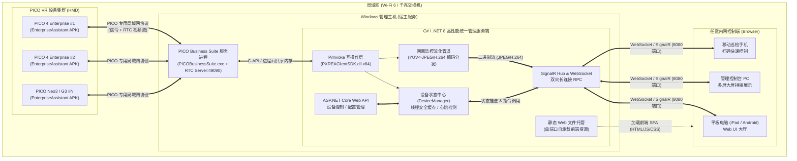

# PICO VR 设备统一管理系统 —— 架构设计与开发文档

---

## 1. 项目背景与需求概述

### 1.1 项目目标
针对企业、展厅、教育实训、线下体验馆等多台 PICO VR 设备的集中管控场景，构建一套**高性能、轻量化、易部署的 PICO VR 设备统一管理系统**。
系统采用 **C/S + B/S 混合架构**：
- **后端服务端（Server）**：部署在 Windows 电脑上，作为宿主程序直接集成 PICO 官方企业应用套件（PICO Business Suite PC SDK），负责与局域网内所有 PICO VR 头显进行低延时底层通信与设备控制。
- **管理客户端（Client）**：无需在每台管理电脑/平板上安装客户端软件，任何接入同局域网（内网）的设备（如管理员 PC、iPad、安卓平板、手机等），均可通过浏览器直接访问后台提供的 Web 界面，实现可视化的多机集中监控与控制。

### 1.2 核心业务功能
1. **设备生命周期与在线感知**：自动发现内网设备上线、掉线预警、休眠感知、重连自恢复。
2. **设备全息状态监控**：
   - 头显电量（0-100%）、充电状态。
   - 左右手柄连接状态与手柄电量。
   - 佩戴检测传感器（已佩戴 / 未佩戴）。
   - 屏幕亮灭状态（亮屏 / 息屏）。
   - 设备型号（如 PICO 4 Ultra Enterprise、PICO Neo 3、PICO G3 等）、系统 PUI 版本、内网 IP/MAC、存储空间、CPU 使用率及核心温度。
3. **应用与内容管控**：
   - 实时感知头显当前运行的前台程序包名（Current Application）。
   - 远程批量/单机启动指定应用（支持无参包名启动，以及携带 JSON 扩展参数启动）。
   - 远程退出当前运行应用。
4. **多路画面实时监控（重点特性）**：
   - 从底层获取头显渲染帧（YUV420P/BGRA），在后台高效转码并通过网络流化至 Web 前端。
   - 支持**多机宫格预览**（低码率/较低帧率，最多支持 25 路并行监控）与**单机高清特写**（自适应动态切换分辨率 360P / 480P / 720P / 1080P）。
5. **播控与系统维护**：
   - 远程设备锁定 / 解锁（播控前置安全锁）。
   - 视频同步播控（播放、暂停、跳转、停止、循环播放、隐藏进度条）。
   - 全景图片推送展示。
   - 系统级音量调节（0-100）。
   - 视角重置（Recenter View）、受控提示框开关。
   - 远程关机与远程重启。

---

## 2. 总体架构设计



### 2.1 架构分层职责

1. **头显端（VR HMD）**：
   - 安装官方企业套件伴侣 APK：`EnterpriseAssistant-HMD.apk`。
   - 开机自启或通过行业设置配置为“企业播控助手”。
   - 负责采集设备传感器、电量、前台应用，并在开启监控时编码传输屏幕画面给 PC 宿主。

2. **Windows 底层驱动与服务层**：
   - 运行官方服务 `PICOBusinessSuite.exe`（在后台托盘静默运行）。
   - 配置文件 `key-setting.ini` 开启 `ServiceMode`。
   - 官方服务在本地维护 RTC 通道（默认 49090 端口）及设备配对通信。

3. **管理系统后台服务（Core Backend）**：
   - 采用 **.NET 8 (C#) / ASP.NET Core** 构建独立 Windows 应用程序（可直接作为后台控制台运行或注册为 Windows 服务）。
   - **理由**：
     - 用户提供的 Demo 为 C#，且官方 SDK 提供了 `PXREAClientSDK.dll` 完整 64 位 C-API。
     - C# 的 P/Invoke 对非托管 C++ 导出库支持极为完善，内存开销与执行性能极高。
     - ASP.NET Core 内置高性能 Kestrel Web 服务器，单进程即可同时承载 **RESTful API**、**SignalR 双向长连接**、**静态 Web 页面服务**，无需额外部署 Nginx 或 IIS，实现“开箱即用”。

4. **Web 前端展示与控制层（Web Frontend）**：
   - 基于 **Vue 3 + Vite + Element Plus + Pinia** 构建现代响应式单页面应用（SPA）。
   - 编译产物打包内置于 C# 服务的 `wwwroot/` 目录，客户端只需在浏览器输入 `http://<Windows_IP>:8080` 即可直接打开。
   - 适配 PC 宽屏、大屏监看墙、平板触控以及移动端视图。

---

## 3. PICO Business Suite SDK 核心机制与接口汇总

根据对官方 `PXREAClientSDK.h`、官方文档以及提供的 C# Demo 项目代码分析，核心规则与接口如下：

### 3.1 运行前置条件
1. **架构匹配**：`PXREAClientSDK.dll` 是纯 **64 位 (x64)** 动态库。C# 编译配置必须显式指定为 `x64`（严禁选择 `Any CPU` 或 `x86`，否则引发 `BadImageFormatException`）。
2. **底层服务模式开启**：
   - 配置文件路径：`C:\Users\<User>\AppData\Local\PICOBusinessSuitData\key-setting.ini`。
   - 确保开启服务端模式（Service Mode），并启动 `PICOBusinessSuite.exe`。
   - 浏览器访问 `http://127.0.0.1:49090/singleCenter/serverStatus`，确保 RTC 服务状态全部为 `Available`。

### 3.2 回调体系与生命周期

SDK 采用标准的 C 风格回调函数指针：
```csharp
[UnmanagedFunctionPointer(CallingConvention.Cdecl)]
public delegate void SDKCallBack(IntPtr context, PXREAClientCallbackType type, int status, IntPtr userData);
```

关键回调事件类型及数据载荷解析：

| 回调类型枚举 (`PXREAClientCallbackType`) | 触发场景 | `userData` 结构体 / 指针内容 | 说明 |
| :--- | :--- | :--- | :--- |
| `PXREAServerConnect` (`1<<2`) | SDK 成功连接上 PC Suite 后台 | `null` | 表明底层套件服务就绪 |
| `PXREAServerDisconnect` (`1<<3`) | PC Suite 崩溃或断开 | `null` | 需触发告警并启动重连机制 |
| `PXREADeviceFind` (`1<<4`) | 头显开机上线 / 连入局域网 | `char*` (设备 SN 字符串) | 将设备加入在线设备池 |
| `PXREADeviceMissing` (`1<<5`) | 头显关机 / 断网 / 离开房间 | `char*` (设备 SN 字符串) | 移除设备，自动停止其画面监控 |
| `PXREADeviceConnect` (`1<<9`) | 设备佩戴握手完成 | `char*` (设备 SN 字符串) | `status`: 0=未佩戴, 1=已佩戴 |
| `PXREADeviceBattery` (`1<<6`) | 收到电量上报 | `PXREADevBattery*` (SN + battery) | 电量范围 0-100% |
| `PXREADeviceSensor` (`1<<10`) | 距离传感器感应佩戴状态变更 | `char*` (设备 SN 字符串) | `status`: 0=摘下头显, 1=戴上头显 |
| `PXREAScreenState` (`1<<18`) | 屏幕亮灭状态反馈 | `char*` (设备 SN 字符串) | `status`: 0=息屏, 1=亮屏 |
| `PXREACurrentApplication` (`1<<16`) | 前台当前运行程序变更 | `PXREACurrentApp*` (SN + appName) | 返回 Android 包名 |
| `PXREADeviceModel` (`1<<15`) | 查询设备型号返回 | `PXREADevModel*` (SN + devModel) | 如 PICO 4 Ultra Enterprise |
| `PXREAControllerBattery` (`1<<17`) | 手柄电量返回 | `PXREACtrllerBattery*` (SN + id + bat)| `controllerID`: 0左手柄, 1右手柄 |
| `PXREADeviceLock` / `Unlock` | 设备锁定/解锁反馈 | `char*` (设备 SN 字符串) | `status`: 0=成功, -1=失败 |
| `PXREADeviceScreenMonitorParameter` | 画面监控通道协商成功 | `PXREAMonitorPara*` (SN + w + h) | 得到流画面宽高等几何参数 |
| `PXREADeviceScreenMonitor` | 实时画面渲染帧到来 | `PXREAFrameBlobMultiplyMonitor*` | **持续触发**，包含像素格式与内存地址 |
| `PXREADeviceStateJson` (`1<<25`) | 高级设备状态 JSON 上报 | `PXREADevStateJson*` | 包含 CPU/GPU 温度、CPU 使用率等 |
| `PXREAVideoControlResult` (`1<<19`) | 播控指令执行结果返回 | `PXREAVideoCtrlResult*` | 动作执行结果详情与错误码 |

### 3.3 关键操作约束：设备锁定（Locking）
> [!IMPORTANT]
> **官方强制规范**：向头显下发以下指令前，**必须先锁定设备（LockDevice）**，否则指令会被头显静默丢弃或报错：
> - 启动应用（`StartPlayApp`）/ 关闭应用（`StopPlayApp`）
> - 启动视频播放（`StartPlayVideo`）/ 暂停 / 跳转 / 停止
> - 全景图片播放（`StartPlayPicture`）
> - 调整音量（`SetDeviceVolumn`）
> - 设置/查询屏幕亮灭（`SetScreenState` / `GetScreenState`）
> - 取消受控提示框（`StopControlDevice`）
>
> **因此，在系统设计中，后台实现“自动静默锁机”策略**：当设备上线（`PXREADeviceFind` / `PXREADeviceConnect`）时，系统自动执行锁定操作，或者在下发任何播控指令前检测锁状态并自动获取锁，以减少前端使用者的操作阻力。

---

## 4. 画面监控（Screen Stream）网络传输方案

多路画面监控是本系统最核心、技术挑战最大的模块。SDK 提供了 `StartMonitorScreen(devID, quality)` 接口，在 C++ 回调 `PXREADeviceScreenMonitor` 中持续回传每一帧的原始未压缩数据。

### 4.1 数据载荷分析
SDK 回传的结构体：
```cpp
typedef struct {
    char devID[32];          // 设备 SN
    int isScreen;            // 0=自定义流(摄像头), 1=屏幕画面
    const char* addr;        // 像素内存起始指针
    unsigned size;           // 数据大小 (字节)
    unsigned width;          // 帧宽度
    unsigned height;         // 帧高度
    unsigned bytesPerLine;   // 行宽跨距 (stride)
    int pixFormat;           // 13 = YUV420P, 4 = BGRA8888
} PXREAFrameBlobMultiplyMonitor;
```

### 4.2 Web 端的实时流化解决方案
1. **多机宫格概览态（默认模式）**：
   - 开启设备监控时指定分辨率为 `Quality360p`（640x360）或 `Quality480P`。
   - 后台通过 C# 高性能非托管指针读取 YUV420P，通过 SIMD / LibJpegTurbo 快速转为 JPEG 字节。
   - 帧率限制器（FPS Limiter）：控制在 10~15 FPS，既保证肉眼观察画面平滑，又避免局域网广播风暴和前端渲染掉帧。
   - 前端接收到二进制流直接写入 `<canvas>` 或使用 `URL.createObjectURL(blob)` 渲染到 ``。
2. **单机高清放大态（点选单机时）**：
   - 前端发起单机聚焦请求，后台调用 `SetMonitorScreenQuality(devID, Quality1080P)` 提升画质。
   - 针对当前聚焦设备提升至 25~30 FPS，实现高清监看。
   - 关闭特写回到宫格时，平滑降级回 360P，释放编码与网络资源。

---

## 5. 后端系统设计与关键代码实现规范

### 5.1 完整的 C# P/Invoke 接口声明 (`PXREAOpenApi.cs`)
```csharp
using System;
using System.Runtime.InteropServices;

namespace PicoManager.Server.Native
{
    public static class PXREAOpenApi
    {
        private const string DllName = "PXREAClientSDK.dll";

        [UnmanagedFunctionPointer(CallingConvention.Cdecl)]
        public delegate void SDKCallBack(IntPtr context, PXREAClientCallbackType type, int status, IntPtr userData);

        // 初始化与生命周期
        [DllImport(DllName, CallingConvention = CallingConvention.Cdecl)]
        public static extern int Init(IntPtr context, SDKCallBack callBack, uint mask);

        [DllImport(DllName, CallingConvention = CallingConvention.Cdecl)]
        public static extern void Deinit();

        // 状态查询
        [DllImport(DllName, CallingConvention = CallingConvention.Cdecl)]
        public static extern int GetBattery(string devID);

        [DllImport(DllName, CallingConvention = CallingConvention.Cdecl)]
        public static extern int GetCurrentApp(string devID);

        [DllImport(DllName, CallingConvention = CallingConvention.Cdecl)]
        public static extern int GetDeviceModel(string devID);

        [DllImport(DllName, CallingConvention = CallingConvention.Cdecl)]
        public static extern int GetControllerBattery(string devID, int controllerID);

        [DllImport(DllName, CallingConvention = CallingConvention.Cdecl)]
        public static extern int GetScreenState(string devID);

        [DllImport(DllName, CallingConvention = CallingConvention.Cdecl)]
        public static extern int GetDeviceAlias(string devID);

        // 播控与锁定
        [DllImport(DllName, CallingConvention = CallingConvention.Cdecl)]
        public static extern int LockDevice(string devID);

        [DllImport(DllName, CallingConvention = CallingConvention.Cdecl)]
        public static extern int UnlockDevice(string devID);

        [DllImport(DllName, CallingConvention = CallingConvention.Cdecl)]
        public static extern int StartControlDevice(string devID);

        [DllImport(DllName, CallingConvention = CallingConvention.Cdecl)]
        public static extern int StopControlDevice(string devID);

        // App 与媒体播控
        [DllImport(DllName, CallingConvention = CallingConvention.Cdecl)]
        public static extern int StartPlayApp(string devID, string appName);

        [DllImport(DllName, CallingConvention = CallingConvention.Cdecl)]
        public static extern int StopPlayApp(string devID, string appName);

        [DllImport(DllName, CallingConvention = CallingConvention.Cdecl)]
        public static extern int StartPlayVideo(string devID, string videoPath);

        [DllImport(DllName, CallingConvention = CallingConvention.Cdecl)]
        public static extern int StopPlayVideo(string devID);

        [DllImport(DllName, CallingConvention = CallingConvention.Cdecl)]
        public static extern int PauseVideo(string devID);

        [DllImport(DllName, CallingConvention = CallingConvention.Cdecl)]
        public static extern int ContinueVideo(string devID);

        [DllImport(DllName, CallingConvention = CallingConvention.Cdecl)]
        public static extern int SeekVideoTime(string devID, int milliseconds);

        // 系统控制
        [DllImport(DllName, CallingConvention = CallingConvention.Cdecl)]
        public static extern int SetDeviceVolumn(string devID, int vol);

        [DllImport(DllName, CallingConvention = CallingConvention.Cdecl)]
        public static extern int SetScreenState(string devID, int screenState);

        [DllImport(DllName, CallingConvention = CallingConvention.Cdecl)]
        public static extern int ShutDownDevice(string devID);

        [DllImport(DllName, CallingConvention = CallingConvention.Cdecl)]
        public static extern int RestartDevice(string devID);

        [DllImport(DllName, CallingConvention = CallingConvention.Cdecl)]
        public static extern int RecenterView(string devID);

        [DllImport(DllName, CallingConvention = CallingConvention.Cdecl)]
        public static extern int SetDeviceAlias(string devID, string alias);

        // 画面监控
        [DllImport(DllName, CallingConvention = CallingConvention.Cdecl)]
        public static extern int StartMonitorScreen(string devID, PXREAMonitorQuality quality);

        [DllImport(DllName, CallingConvention = CallingConvention.Cdecl)]
        public static extern int SetMonitorScreenQuality(string devID, PXREAMonitorQuality quality);

        [DllImport(DllName, CallingConvention = CallingConvention.Cdecl)]
        public static extern int StopMonitorScreen(string devID);

        // 扩展 JSON 指令
        [DllImport(DllName, CallingConvention = CallingConvention.Cdecl)]
        public static extern int DeviceControlJson(string devID, string parameterJson);
    }
}
```

### 5.2 状态结构体与枚举定义 (`NativeTypes.cs`)
```csharp
using System;
using System.Runtime.InteropServices;

namespace PicoManager.Server.Native
{
    public enum PXREAClientCallbackType : uint
    {
        PXREAFrameCaptureStart = 1,
        PXREAFrameCaptureStop = 1 << 1,
        PXREAServerConnect = 1 << 2,
        PXREAServerDisconnect = 1 << 3,
        PXREADeviceFind = 1 << 4,
        PXREADeviceMissing = 1 << 5,
        PXREADeviceBattery = 1 << 6,
        PXREADeviceLock = 1 << 7,
        PXREADeviceUnlock = 1 << 8,
        PXREADeviceConnect = 1 << 9,
        PXREADeviceSensor = 1 << 10,
        PXREADeviceShutdown = 1 << 11,
        PXREADeviceResume = 1 << 12,
        PXREADeviceModel = 1 << 15,
        PXREACurrentApplication = 1 << 16,
        PXREAControllerBattery = 1 << 17,
        PXREAScreenState = 1 << 18,
        PXREAVideoControlResult = 1 << 19,
        PXREADeviceScreenMonitorParameter = 1 << 20,
        PXREADeviceScreenMonitor = 1 << 21,
        PXREADeviceAlias = 1 << 24,
        PXREADeviceStateJson = 1 << 25,
        PXREADeviceCustomMessage = 1 << 26,
        PXREAFullMask = 0xffffffff
    }

    public enum PXREAMonitorQuality
    {
        Quality480P = 0,
        Quality720P = 1,
        Quality1080P = 2,
        Quality2K = 3,
        Quality360p = 4,
        QualityUserConfig = 1000
    }

    [StructLayout(LayoutKind.Sequential, CharSet = CharSet.Ansi)]
    public struct PXREADevBattery
    {
        [MarshalAs(UnmanagedType.ByValTStr, SizeConst = 32)]
        public string devID;
        public uint battery;
    }

    [StructLayout(LayoutKind.Sequential, CharSet = CharSet.Ansi)]
    public struct PXREACurrentApp
    {
        [MarshalAs(UnmanagedType.ByValTStr, SizeConst = 32)]
        public string devID;
        [MarshalAs(UnmanagedType.ByValTStr, SizeConst = 128)]
        public string appName;
    }

    [StructLayout(LayoutKind.Sequential, CharSet = CharSet.Ansi)]
    public struct PXREADevModel
    {
        [MarshalAs(UnmanagedType.ByValTStr, SizeConst = 32)]
        public string devID;
        [MarshalAs(UnmanagedType.ByValTStr, SizeConst = 32)]
        public string devModel;
    }

    [StructLayout(LayoutKind.Sequential, CharSet = CharSet.Ansi)]
    public struct PXREACtrllerBattery
    {
        [MarshalAs(UnmanagedType.ByValTStr, SizeConst = 32)]
        public string devID;
        public int controllerID; // 0: 左手柄, 1: 右手柄
        public uint battery;
    }

    [StructLayout(LayoutKind.Sequential, CharSet = CharSet.Ansi)]
    public struct PXREAFrameBlobMultiplyMonitor
    {
        [MarshalAs(UnmanagedType.ByValTStr, SizeConst = 32)]
        public string devID;
        public int isScreen;
        public IntPtr addr;
        public uint size;
        public uint width;
        public uint height;
        public uint bytesPerLine;
        public int pixFormat; // 13: YUV420P, 4: BGRA8888
    }

    [StructLayout(LayoutKind.Sequential, CharSet = CharSet.Ansi)]
    public struct PXREADevStateJson
    {
        [MarshalAs(UnmanagedType.ByValTStr, SizeConst = 32)]
        public string devID;
        [MarshalAs(UnmanagedType.ByValTStr, SizeConst = 256)]
        public string stateJson;
    }

    [StructLayout(LayoutKind.Sequential, CharSet = CharSet.Ansi)]
    public struct PXREAVideoCtrlResult
    {
        [MarshalAs(UnmanagedType.ByValTStr, SizeConst = 32)]
        public string devID;
        [MarshalAs(UnmanagedType.ByValTStr, SizeConst = 32)]
        public string action;
        public int result;
        [MarshalAs(UnmanagedType.ByValTStr, SizeConst = 128)]
        public string detail;
        public int errorcode;
    }
}
```

---

## 6. 前端 Web 管理界面原型设计

访问方式：同局域网设备输入 `http://<服务器内网IP>:8080`。

### 6.1 页面布局与模块规划

```
+-----------------------------------------------------------------------------------+
|  [Logo] PICO VR 设备统一管控平台       局域网IP: 192.168.1.100:8080   在线: 12/15台  |
+-----------------------------------------------------------------------------------+
| [全局批量操作栏]                                                                   |
| [全选] [一键锁定] [一键解锁] [批量启动App] [批量退出App] [静音/设音量] [批量关机/重启] |
+-----------------------------------------------------------------------------------+
| [设备大厅 / 监控宫格]                               [布局切换: 宫格监控 | 紧凑列表] |
|                                                                                   |
| +-------------------------+ +-------------------------+ +-----------------------+ |
| | PICO 4 #01   [已锁定]   | | PICO 4 #02   [自由]     | | PICO Neo3 #03 [未佩戴]| |
| | 电量: 85%⚡ | 屏幕: 亮   | | 电量: 42%   | 屏幕: 亮   | | 电量: 98%   | 屏幕: 息  | |
| | 手柄: L:90% R:85%       | | 手柄: L:50% R:50%       | | 手柄: 未连接          | |
| | 当前运行: com.vr.demo   | | 当前运行: 系统主页      | | 当前运行: -           | |
| |+-----------------------+| |+-----------------------+| |+---------------------+| |
| ||                       || ||                       || || [画面监控未开启]     || |
| ||   [实时画面 360P]     || ||   [实时画面 360P]     || || 点击开启            || |
| ||   15 FPS              || ||   15 FPS              || ||                     || |
| |+-----------------------+| |+-----------------------+| |+---------------------+| |
| | [启动App] [放大] [更多] | | [启动App] [放大] [更多] | | [启动App] [放大] [更多]| |
| +-------------------------+ +-------------------------+ +-----------------------+ |
+-----------------------------------------------------------------------------------+
```

---

## 7. 部署指南与后续实施

1. **部署步骤**：
   - 宿主机配置：Windows 10/11，安装并运行 `PICO Business Suite`。
   - 将生成的 `PicoManager.Server.exe` 与官方 SDK 的 `PXREAClientSDK.dll`、`PBXRPanoramaUnity_x64.dll` 放置在同级目录。
   - 开放防火墙 `8080` 端口入站。
   - 运行程序，在浏览器访问即可开始多机统一管控。
